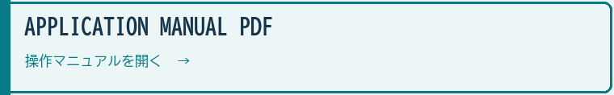
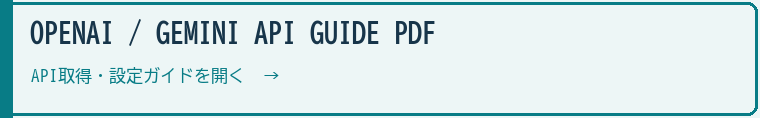

# AI Character Sheet Maker / AIキャラクターシートメーカー

**Gemini model route / Geminiモデル候補**: `gemini-3.8-flash` → `gemini-3.6-flash` → `gemini-3.5-flash-lite` → `gemini-3.1-flash-lite`. Explicit stable IDs avoid the December 1, 2026 redirects; image-generation models keep their dedicated routes. / 2026年12月1日の旧モデル自動転送に依存しないよう、現行GAモデルを明示します。画像生成は専用のモデル経路を使います。

> **MIT License; your outputs remain yours.** You may use, modify, redistribute and sell the app, including in paid products and services, without individual permission from FURU. Retain the copyright and MIT license notices in copies or substantial portions of the software. External API fees and third-party terms are separate. / **アプリはMITライセンス。成果物の権利は従来どおり利用者に帰属します。** アプリの利用・改変・再配布・販売、有料商品やサービスへの組み込みに、FURUへの個別許可は不要です。ソフトウェアの複製または重要な部分には著作権表示とMITの許諾表示を残してください。外部API料金と第三者の条件は別です。

[](https://furuyan1234.github.io/character-sheet-maker/)

Demo URL / デモサイト: [https://furuyan1234.github.io/character-sheet-maker/](https://furuyan1234.github.io/character-sheet-maker/)

### PDF manuals / PDFマニュアル

Japanese A4 guides cover application operation and OpenAI / Gemini API setup. / 日本語A4版でアプリの操作とOpenAI・Gemini APIの取得・設定を説明します。

[](https://furuyan1234.github.io/character-sheet-maker/downloads/character-sheet-maker-manual.pdf)

[](https://furuyan1234.github.io/character-sheet-maker/downloads/character-sheet-maker-api-guide.pdf)


> **A visible-parameter character design tool for manga, story, and AI image workflows.** / **漫画・物語・AI画像生成のために、キャラクター設計を見えるパラメータへ分解する制作支援ツールです。**
> 
 [](https://youtu.be/pqYVxUUg0Cs?si=27g1I3tO2EuZkOuxJ)

AI Character Sheet Maker creates structured character reference sheets from dozens of editable design axes instead of relying on a single free-form prompt. It is designed to feed downstream systems such as **Super FURU AI 4-koma System**, Story Maker, and manual ChatGPT / Gemini image workflows. / AIキャラクターシートメーカーは、自由入力プロンプトだけに頼らず、多数の編集可能な設計軸からキャラクター参照シートを作るツールです。**Super FURU AI 4-koma System**、Story Maker、ChatGPT / Gemini の画像生成ワークフローへ渡しやすい、構造化されたキャラクター資料を作ることを目的にしています。

> **Demo / 公開版**
> [https://furuyan1234.github.io/character-sheet-maker/](https://furuyan1234.github.io/character-sheet-maker/)

---

## Current Release Line / 現行仕様

Version **v1.5.6** is a browser-based React/Vite app with session-only API keys, dual Gemini/OpenAI routing, A/B comparison, parameter locks, deterministic Japanese profile typesetting for form-driven sheets, automatically named prompt-file downloads, exact `1120x1584` output, and provenance watermarking. It also embeds versioned design JSON in generated PNGs so the exact prompt can be restored later. / **v1.5.6** はブラウザ上で動作する React/Vite アプリで、セッション限定APIキー、Gemini/OpenAIの切り替え、A/B比較、項目ロック、フォーム生成時の日本語プロフィール決定的文字合成、自動命名されるプロンプトファイルの直接ダウンロード、1120x1584の固定出力、来歴ウォーターマークを備えています。生成PNGにはバージョン付き設計JSONも埋め込み、後から正確なプロンプトを復元できます。

| Area / 領域 | Current behavior / 現行挙動 |
|---|---|
| App version / バージョン | `1.5.6`, displayed in the API gate, header, footer, and watermark.  / APIゲート、ヘッダー、フッター、透かしに1.5.6を表示します。|
| API key handling / APIキー | Memory-only. Keys are not written to localStorage, source files, or output images.  / メモリ限定。キーをlocalStorage、ソース、出力画像へ書き込みません。|
| Gemini text / Geminiテキスト | `gemini-3.8-flash` → `gemini-3.6-flash` → `gemini-3.5-flash-lite` → `gemini-3.1-flash-lite` |
| Gemini image / Gemini画像 | `gemini-nano-banana-2.1` |
| OpenAI text / OpenAIテキスト | Select from all 8 models; default gpt-6.1-sol, downward fallback from the selection. / 全8モデルから選択（既定 `gpt-6.1-sol`、選択から下位のみ） |
| OpenAI image / OpenAI画像 | `gpt-image-2.6-sunburst` (`xhigh`); no automatic model fallback / 自動モデル切替なし |
| Output canvas / 出力キャンバス | The final PNG is exactly `1120x1584` (`70:99`, the same ratio as A4). The complete provider artwork is fitted below the Japanese profile header without cropping.  / 最終PNGは1120x1584（70:99、A4と同比率）です。生成イラストを切り抜かず日本語プロフィールヘッダーの下へ収めます。|
| Image import / 画像読み込み | Generated PNGs contain `furu.character_sheet` schema v1 JSON for exact prompt restoration. PNG and JPG/JPEG images can be dropped or selected; images without this metadata use AI prompt inference.  / 生成PNGにはfuru.character_sheetスキーマv1の設計JSONを埋め込み、正確なプロンプトを復元します。PNG・JPG/JPEGをドロップまたは選択でき、設計情報がない画像はAIでプロンプトを推定します。|
| Local port / ローカルポート | `http://127.0.0.1:5176/` with Vite `strictPort: true`. |

---

## Core Concept / 基本コンセプト

Most AI character generation failures come from vague prompts: the same adjectives are reused, anatomy changes from image to image, and the resulting character is hard to carry into manga panels or story scenes. This app turns character design into a visible control surface. / AIキャラクター生成で起きる失敗の多くは、曖昧なプロンプトから始まります。同じ形容詞が何度も使われ、身体・衣装・口調・役割が画像ごとに揺れ、漫画や物語へ持ち込めないキャラクターになります。このアプリは、キャラクター設計を見える操作面へ変換します。

The user edits concrete axes such as body build, face type, costume, role, voice image, action tendency, emotion range, transformation state, and manga-direction metadata. The app then assembles those axes into a provider-specific prompt and renders a normalized character sheet. / ユーザーは、体型、顔立ち、衣装、役割、声質イメージ、得意アクション、感情レンジ、覚醒状態、漫画演出連携情報などを具体的に編集します。アプリはそれらの軸をプロバイダー向けプロンプトへ組み立て、正規化されたキャラクターシートとして出力します。

---

## Workflow / 操作フロー

1. **Select provider / プロバイダー選択**
   Choose Gemini or OpenAI in the API gate and enter the matching API key. / APIゲートでGeminiまたはOpenAIを選択し、対応するAPIキーを入力します。

2. **Design the character / キャラクター設計**
   Edit dropdowns, text fields, and textarea fields across the visible sections. / 表示されている各欄のプルダウン、テキスト入力、複数行入力を編集します。

3. **Lock important axes / 重要項目をロック**
   Lock fields that must not change during randomization or AI text generation. / ランダム化やAI文章生成で変更したくない項目をロックします。

4. **Use presets or full random / プリセット・全体ランダム**
   Apply one of the representative-character presets or run the gacha-style randomizer. Smart linkage keeps combinations coherent. Use **キャラ固定** to preserve the character's identity, then use the same single preset row as appearance themes; **固定解除** returns those buttons to full-character presets. / 代表キャラのプリセットかガチャ風ランダム化を使います。スマート連携で組み合わせを整えます。「キャラ固定」は人物像を保持しながら見た目だけを試し、「固定解除」で完全なプリセット適用へ戻します。

5. **Generate text details / テキスト詳細生成**
   Let the selected LLM propose names, catchphrases, dialogue, likes, dislikes, nicknames, and similar textual details when needed. / 必要に応じて、選択したLLMに名前、口癖、台詞、好き嫌い、呼び名などの文章項目を提案させます。

6. **Generate the sheet / シート生成**
   Send the provider-specific prompt to Gemini or OpenAI image generation. / プロバイダー別のプロンプトをGeminiまたはOpenAIの画像生成へ送信します。

7. **Typeset, normalize, and compare / 文字合成・正規化・比較**
   The app adds the exact profile fields in a Japanese header, fits the complete provider artwork below it without cropping, and applies the version watermark. The final PNG is always 1120x1584 (70:99, the same ratio as A4). A/B mode allows two slots to be compared side by side. / アプリが正確なプロフィール項目を日本語ヘッダーへ合成し、生成イラストを切り抜かずその下へ収め、バージョンの透かしを付けます。最終PNGは常に1120x1584（70:99、A4と同比率）です。A/Bモードでは2つのスロットを並べて比較できます。

8. **Download or reuse / 保存・再利用**
   Download the current prompt with its automatic character-based filename, download PNG output, or load previous image session thumbnails for comparison. Generated PNGs retain the exact prompt as versioned design data; drop one onto the result region to display that image and restore its prompt without image analysis. / 人物に基づく自動ファイル名で現在のプロンプトやPNGを保存し、履歴の画像を読み込んで比較できます。生成PNGには正確なプロンプトを版付き設計データとして保存し、結果欄へドロップすると画像解析をせず画像とプロンプトを復元します。

---

## Feature Map / 機能マップ

### 1. API Gate / APIゲート

The app starts locked until the user selects Gemini or OpenAI and enters an API key. The key stays only in memory for the current browser session. / アプリはAPIキー入力前にはロック状態です。Gemini または OpenAI を選び、対応するキーを入力してから制作画面へ進みます。キーは現在のブラウザセッション内のメモリにのみ保持されます。

* Gemini key acquisition link: Google AI Studio. / Geminiキーの取得リンク：Google AI Studio。
* OpenAI key acquisition link: OpenAI Platform. / OpenAIキーの取得リンク：OpenAI Platform。
* API switch button returns to the gate without persisting the previous key. / API切替ボタンは、前のキーを永続保存せずAPIゲートへ戻ります。
* Reloading the page requires entering the key again. / ページを再読み込みした場合はキーの再入力が必要です。

### 2. Visible Character Axes / 見えるキャラクター設計軸

The current UI organizes fields into nine main sections: / 現在のUIは、以下の9セクションに項目を整理しています。

| Section / セクション | Main fields / 主な項目 |
|---|---|
| 1. 生体・身体・精神プロファイル | name, sex, species, age, height, weight, body build, personality, likes, dislikes, catchphrase, dialogue  / 名前、性別、種族、年齢、身長、体重、体型、性格、好き嫌い、口癖、台詞|
| 2. 顔・頭部・メイク詳細 | face type, eye shape, eye color, makeup, hair style, hair color, facial hair, skin type  / 顔立ち、目の形・色、化粧、髪型・髪色、ひげ、肌|
| 3. 装飾品・紋様・特殊部位 | glasses, head accessory, earrings, neck accessory, piercings, body art, wings, horns, tail, mechanical arms  / 眼鏡、頭・耳・首の装飾、ピアス、ボディアート、翼、角、尾、機械腕|
| 4. 衣装・装備・エフェクト | world era, costume, material, outfit condition, fit, weapon, sub weapon, magic effect, aura  / 世界観の時代、衣装、素材、衣装の状態・フィット、武器、補助武器、魔法効果、オーラ|
| 5. 画風・レンダリング・陰影 | art style, layout, rendering mode, screentone, pen style, lighting, shadow, color theme  / 画風、レイアウト、描画方式、スクリーントーン、ペン、光、影、色テーマ|
| 6. ポーズ・表現 | base pose, expression, gaze direction, hand expression  / 基本ポーズ、表情、視線、手の表現|
| 7. ロール・演技設定 | archetype, nickname, organization, voice type, speech style  / 類型、呼び名、所属、声の種類、口調|
| 8. マンガ演出連携 | action tendency, emotion range, direction style, awakening / transformation  / 得意アクション、感情レンジ、演出傾向、覚醒・変身|
| 9. 自由記述 | free-form extra detail for anything the fixed controls cannot express  / 固定項目で表現できない内容を補う自由入力|

This structure is intentionally dense. The goal is to make character continuity easier to inspect before an image is generated, not to hide design decisions inside a single paragraph. / この構造は意図的に細かくしています。目的は、画像生成前にキャラクターの一貫性を見て確認できるようにすることであり、設計判断を1つの長文プロンプトの中へ隠すことではありません。

### 3. Parameter Locks / パラメータロック

Each editable field can be locked. Locked fields are preserved when the user runs random generation or asks the AI to fill missing text fields. / 各編集項目はロックできます。ロックした項目は、全体ランダムやAIによるテキスト補完を実行しても保持されます。

This is especially useful for: / 特に次の用途に使えます。

* Keeping a fixed sex/species/age while exploring costume or pose. / 性別・種族・年齢を固定して、衣装やポーズを試す。
* Holding a weapon and action tendency while changing art style. / 武器と得意アクションを維持しながら画風を変える。
* Preserving a name, catchphrase, or speech style across multiple visual attempts. / 複数の作画で名前、口癖、話し方を維持する。
* Comparing two designs with only one or two axes changed. / 1～2項目だけを変えた2つの設計を比較する。

### 4. Smart Linkage Engine / スマート連携エンジン

Randomization is not purely uniform. The app applies light-weight consistency rules so random characters are less likely to become incoherent. / ランダム生成は完全な無作為ではありません。設定同士が破綻しにくいように、軽量な整合ルールを挟んでいます。

Examples: / 例：

* Child age groups are nudged toward smaller body builds. / 子供の年齢区分では、小さめの体型を選びやすくします。
* Certain species imply suitable body types or special parts. / 種族に合わせて体型や特殊部位を選びます。
* Military and cyberpunk worlds can bias weapons or goggles. / 軍事やサイバーパンクの世界観は、武器やゴーグルの選択に影響します。
* Sex and character type can influence speech style, body build, and voice image. / 性別とキャラの種類は、口調、体型、声のイメージに影響します。
* Non-combat roles are less likely to receive heavy weapons unless the user locks them. / 利用者が固定していない限り、非戦闘の役割では重武器を選びにくくします。

These are generic linkage rules, not hardcoded examples for one character. / これらは特定キャラ用の一回限りの分岐ではなく、汎用的な連携ルールです。

### 5. Preset Templates / プリセットテンプレート

The app includes ready-to-use starting points: / すぐに使える次の初期プリセットを用意しています。

* Dark fantasy warrior / ダークファンタジー戦士
* School romantic-comedy heroine / 学園ラブコメヒロイン
* Cyberpunk mercenary / サイバーパンク傭兵
* Japanese supernatural swordsman / 和風伝奇の剣客
* Isekai mage / 異世界魔導師
* Retro monster-movie creature / レトロ怪獣映画の怪物

Presets are complete starting characters: they include identity, personality, catchphrase, dialogue, and a themed appearance. Every applied field remains editable. When **キャラ固定** is active, the same one-row buttons change only the non-identity visual/theme fields; **固定解除** restores full-preset behavior. / プリセットは人物像・性格・口癖・台詞・見た目まで含む開始キャラクターであり、適用後もすべての項目を編集できます。**キャラ固定**中は同じ一列のボタンが見た目テーマのみを変更し、**固定解除**で完全なプリセット適用に戻ります。

### 6. A/B Compare Mode / A/B比較モード

A/B mode maintains two independent slots. Each slot can hold its own parameters and generated image. / A/B比較モードでは、2つの独立したスロットを保持します。各スロットはそれぞれ別の設定値と生成画像を持てます。

Typical uses: / 主な用途：

* Compare Gemini and OpenAI outputs from similar settings. / 同じような設定からGeminiとOpenAIの出力を比較する。
* Keep Slot A as the stable design and use Slot B for risky style changes. / Aを基準の設計として残し、Bで大きな画風変更を試す。
* Test whether a character is more readable in 12-panel reference layout or three-view structural layout. / 12枠の参照レイアウトと三面図の構造レイアウトで、人物の見やすさを比較する。
* Compare subtle changes in voice image, action tendency, or facial expression. / 声のイメージ、得意アクション、表情の細かな違いを比較する。

### 7. Session History / セッション履歴

Generated images are kept as session thumbnails. Users can reload a previous image into the current slot or delete individual entries. / 生成された画像はセッション内のサムネイル履歴として保持されます。過去画像を現在スロットへ戻したり、個別削除したりできます。プロンプトはキャラクター名から自動命名されたUTF-8テキストファイルとして直接ダウンロードできます。

This history is for short-term creative comparison. It is not a long-term database and is not a place to store API keys. / この履歴は短時間の比較用です。長期保存データベースではなく、APIキーを保存する場所でもありません。

### 8. Editable PNG Design Data / PNG設計データの保存・復元

Every newly generated PNG contains an uncompressed PNG `iTXt` chunk under the dedicated key `furu.character_sheet`. The schema v1 JSON stores the exact prompt, character fields, app version, timestamp, and non-secret generation details such as model and canvas size. API keys are never embedded. / 新しく生成するPNGには、専用キー `furu.character_sheet` の非圧縮PNG `iTXt` チャンクを埋め込みます。schema v1のJSONには、完全なプロンプト、キャラクター項目、アプリバージョン、生成日時、モデル名・キャンバス寸法などの非機密な生成情報を保存します。APIキーは埋め込みません。

The top toolbar advertises **PNG設計保存・復元 / PNG・JPG解析**. Drop a PNG or JPG/JPEG onto the generated-image region, or focus the region and press Enter to choose a file. The dropped image replaces the displayed result, and a persistent line below it names the loaded file. When a PNG contains app metadata, the exact prompt is restored. A JPEG or a PNG without app metadata is sent to the selected AI provider for an inferred prompt. The line identifies that prompt as an AI estimate, not the original, and shows analysis progress or failure. This API call can incur charges. **クリア** empties only the prompt preview; changing any character field resumes the live prompt. / 上部メニューには **PNG設計保存・復元 / PNG・JPG解析** を表示します。PNGまたはJPG/JPEGを生成結果領域へドロップするか、その領域へフォーカスして Enter を押してファイルを選ぶと、表示画像がその画像に切り替わり、結果欄の下にファイル名が残ります。PNGに専用メタデータがあればプロンプトを正確に復元します。JPG/JPEGや設計データのないPNGは選択中のAIへ送って画像を解析し、推定プロンプトを作ります。この場合はAPI使用料が発生する可能性があり、元のプロンプトを完全に再現するものではありません。結果欄には解析中・推定完了・失敗も表示します。**クリア** はプロンプト表示だけを空にし、いずれかのキャラクター項目を変更するとリアルタイム生成へ戻ります。

The top one-line status reports the selected file, analysis progress/model, and final result or failure; the result remains visible until dismissed or replaced. AI analysis separates observable identity from presentation: it records hair structure and endpoints, facial geometry, clothing layers and accessory placement, retains known left/right relationships, and leaves occluded traits unknown. The displayed English prompt puts identity first, then pose/background, then preservation rules. Analysis may use more output tokens than before; a truncated or invalid response fails instead of silently dropping details. Pressing image generation uses the displayed prompt as text only: the imported image is not sent as a generation reference. When the prompt came from a restored or AI-inferred image, the result is a new image without a conflicting Japanese profile header from the current form, and the result panel explicitly says which prompt source was used. Even an exact restored PNG prompt does not guarantee a pixel-identical image; an AI-inferred prompt is an approximation whose visual fidelity must be judged from actual outputs. / 画面上の「設計プロンプト」欄には、リアルタイム更新・PNGからの復元・AI画像解析のいずれの結果も表示します。「生成結果・画像ドロップ（PNG/JPG）」欄は画像の表示と読み込みを兼ねます。

Because the prompt and character fields are stored inside the PNG, treat the image as carrying those design details when sharing it with another person or service. / 上部の1行ステータスには、対象ファイル・解析中のモデル・完了または失敗を表示し、閉じるか別の操作をするまで結果を残します。画像解析では髪型の分け目・毛先位置、顔の形、衣装の内外の重なり、アクセサリーの位置など、見える識別特徴と姿勢・背景を分けて記録します。左右が確かな部分だけを保持し、隠れた部分は推測で補いません。表示する英語プロンプトは人物の同一性を先に、姿勢・背景を次に、保持条件を最後に配置します。解析応答が長くなる場合がありますが、途中で切れた結果や不正な形式は特徴を黙って削らず失敗として表示します。「画像生成」は表示中のプロンプトをテキストとして使う新規生成で、読み込んだ画像自体は参照画像として送られません。復元・AI推定プロンプトから再生成する場合は、現在のフォーム値と矛盾する日本語プロフィール欄を合成せず、プロンプト欄直下と結果欄に出所を表示します。PNGから元プロンプトを正確に復元しても画像の完全一致は保証されず、AI推定プロンプトの再現度は実際の生成画像で確認する必要があります。

The PNG itself contains the prompt and character fields. Sharing the image with another person or external service also shares that design information. / PNG自体にプロンプトとキャラクター項目が含まれるため、他者や外部サービスへ画像を渡す場合は、その設計情報も共有されるものとして扱ってください。

---

## Provider Architecture / プロバイダー構成

### Gemini

Gemini is used for both text assistance and image generation. The text layer uses a fallback chain, while the image layer currently uses `gemini-nano-banana-2.1`. / Geminiはテキスト補助と画像生成の両方に使われます。テキスト層はフォールバックチェーンを使い、画像層は現行では `gemini-nano-banana-2.1` を使用します。

Text fallback: / 文章モデルの切替：

```text
gemini-3.8-flash
-> gemini-3.6-flash
-> gemini-3.5-flash-lite
-> gemini-3.1-flash-lite
```

Image model: / 画像モデル：

```text
gemini-nano-banana-2.1
```

### OpenAI

OpenAI is used for text assistance and image generation through the current OpenAI API paths. / OpenAIは、現行OpenAI API経路でテキスト補助と画像生成に使われます。

Text fallback: / 文章モデルの切替：

```text
gpt-6.1-sol (default; Astra is selectable above)
-> gpt-6.1-terra
-> gpt-6-sol
-> gpt-5.6-sol
-> gpt-5.6-terra
-> gpt-6-luna
-> gpt-5.6-luna
```

Image fallback: / 画像モデルの切替：

```text
gpt-image-2.6-sunburst (xhigh)
(no automatic image-model fallback / 画像モデルの自動切替なし)
```

### Provider Boundary / プロバイダー境界

The same design data is used for both providers, but provider-specific prompt and API handling live in separate modules. This keeps the UI consistent while allowing each provider path to handle its own model behavior. / 同じ設計データを両プロバイダーで使いますが、プロンプトとAPI処理はプロバイダー別モジュールに分けています。UIは共通に保ちつつ、各プロバイダーの挙動に合わせた処理を行うためです。

---


Image-to-prompt analysis uses `gpt-6-luna` independently of the text selector. It explicitly requests JSON output and validates the complete structured identity contract before adoption. / 画像からプロンプトを作る解析は、文章モデル選択とは独立した`gpt-6-luna`を使用します。JSON形式を明示的に要求し、人物特徴の構造化出力を検証してから採用します。

## Output Contract / 出力仕様

Generated images are normalized after the provider returns the image. / プロバイダーから画像が返ったあと、出力画像はアプリ側で正規化されます。

* Artwork area: the complete provider image is contained below the profile header without cropping. / イラスト領域：生成画像全体を切り抜かず、プロフィールヘッダーの下へ収めます。
* Final PNG: exactly `1120x1584`. / 最終PNG：1120x1584固定。
* Aspect ratio: `70:99`, the same ratio as A4 (`210:297`). / 縦横比：70:99。A4（210:297）と同比率です。
* File type: PNG / ファイル形式：PNG
* Embedded design data: `furu.character_sheet` schema v1 JSON in an `iTXt` chunk; exact prompt restoration without pixel analysis. / 埋め込み設計データ：iTXtチャンクにfuru.character_sheetスキーマv1のJSONを保存し、画素解析をせず正確なプロンプトを復元します。
* Profile text: exact Japanese character information is rendered by the app above the illustration. / プロフィール文字：正確な日本語の人物情報を、アプリがイラストの上に合成します。
* Watermark: `Generated by Super FURU AI Character Sheet v1.5.6`
* Watermark position: bottom-right / 透かし位置：右下。
* Filename pattern: `character_sheet_<timestamp>.png`

The normalization and typesetting steps make downstream use more predictable. A character sheet can be passed to another AI, attached as a visual reference, or read by OCR-oriented manga systems. Text rendered inside the illustration itself can still vary by provider. / 正規化によって、後段利用が安定します。任意サイズの画像をそのまま扱うのではなく、別AIへの参照画像、漫画制作のキャラクター資料、OCR前提の資料として扱いやすい縦長シートへそろえます。

---

## Integration With Super FURU / Super FURU連携

This app is part of the same creative tool ecosystem as **Super FURU AI 4-koma System**. / このアプリは **Super FURU AI 4-koma System** と同じ創作ツール群の一部です。

The generated sheet can be used to: / 生成したシートは次の用途に使えます。

* Provide a stable character reference before four-panel manga generation. / 4コマ漫画生成前の安定したキャラクター参照にする。
* Preserve visible design decisions that would otherwise be lost inside a prompt. / プロンプトの中に埋もれがちな、表示上の設計判断を保持する。
* Supply manga-direction metadata such as action tendency, emotion range, direction style, and awakening state. / 得意アクション、感情レンジ、演出傾向、覚醒状態などの漫画演出情報を渡す。
* Help downstream tools distinguish a character's role, voice image, costume, and visual silhouette. / 連携先のツールが人物の役割、声のイメージ、衣装、シルエットを区別するために使う。

Generated sheets provide character references before manga generation, preserve design decisions otherwise buried in prompts, and pass on action tendencies, emotional range, direction and awakening metadata. / 生成シートは、4コマ漫画生成前のキャラクター参照、プロンプト内に埋もれがちな設計判断の保持、得意アクション・感情レンジ・演出傾向・覚醒状態などの漫画演出メタデータの受け渡しに使えます。

---

## Setup & Launch / セットアップと起動

### Public version / 公開版

Use the GitHub Pages build: / GitHub Pagesの公開版を使用します。

```text
https://furuyan1234.github.io/character-sheet-maker/
```

### Local development / ローカル開発

```powershell
npm install
npm run dev
```

The Vite dev server uses: / Vite開発サーバーの接続先は次のとおりです。

```text
http://127.0.0.1:5176/
```

The repository also includes: / リポジトリには次のファイルも含みます。

```text
start_character_sheet_app.bat
```

This launcher is intended for Windows users who want to start the local app without typing the npm command each time. / この起動バッチは、毎回npmコマンドを入力せずにローカルアプリを開きたいWindows利用者向けです。

### Build / ビルド

```powershell
npm run build
```

The production build uses a relative Vite base (`./`) so the app can be deployed to GitHub Pages. / 本番ビルドではViteのbaseを `./` にしており、GitHub Pages配布で動作しやすい構成です。

---

## File Structure / ファイル構成

```text
character_sheet/
├─ index.html
├─ package.json
├─ vite.config.js
├─ start_character_sheet_app.bat
├─ src/
│  ├─ App.jsx
│  ├─ App.css
│  ├─ index.css
│  ├─ main.jsx
│  ├─ components/
│  │  ├─ FieldInput.jsx
│  │  └─ NeuralForge.jsx
│  └─ lib/
│     ├─ ai-provider.js
│     ├─ gemini.js
│     ├─ imagen.js
│     ├─ openai.js
│     ├─ options.js
│     └─ prompt.js
├─ scripts/
│  ├─ generate_release_text.js
│  └─ update_version.js
├─ docs/
│  ├─ deploy.md
│  └─ project_standards.md
├─ AGENTS.md
├─ HANDOFF.md
└─ README.md
```

### Important modules / 主要モジュール

| File / ファイル | Role / 役割 |
|---|---|
| `src/App.jsx` | Main UI state, API gate, randomization, locks, A/B slots, history, download, canvas normalization.  / 主画面の状態、APIゲート、ランダム化、ロック、A/Bスロット、履歴、保存、キャンバス正規化。|
| `src/lib/options.js` | All option lists, sections, default values, backup text data, and presets.  / 選択肢、欄、初期値、バックアップ用文章データ、プリセット。|
| `src/lib/prompt.js` | Provider-neutral character prompt construction.  / プロバイダーに依存しない人物プロンプトの構築。|
| `src/lib/gemini.js` | Gemini text model calls and model fallback.  / Gemini文章モデルの呼び出しと切替。|
| `src/lib/imagen.js` | Gemini image generation path.  / Geminiの画像生成経路。|
| `src/lib/openai.js` | OpenAI text and image generation paths.  / OpenAIの文章・画像生成経路。|
| `src/components/FieldInput.jsx` | Reusable field component with lock and AI-fill controls.  / ロックとAI補完を持つ共通入力部品。|

---

## Security Notes / セキュリティ方針

* API keys are kept in React state only. / APIキーはReact stateだけに保持します。
* API keys are not stored in localStorage. / APIキーをlocalStorageへ保存しません。
* API keys are not written to generated images or metadata. / APIキーを生成画像やメタデータへ書き込みません。
* The app does not include bundled secret keys. / 秘密鍵をアプリへ同梱しません。
* Users must enter their own Gemini or OpenAI API key in the UI. / 利用者自身のGeminiまたはOpenAIのAPIキーを画面へ入力します。
* Browser reload clears the key. / ブラウザーの再読み込みでキーを消去します。
* API requests send the key and necessary text/images directly from the browser to the selected Gemini/OpenAI provider; the app operator does not relay API requests. / キーと必要な文章・画像をブラウザーから選択したGemini／OpenAIへ直接送信し、アプリ運営者はAPIリクエストを中継しません。

API keys remain only in React state and are not stored in localStorage or files. The public app bundles no secret key and uses only the user's UI-entered key, which is cleared on reload. The browser sends the key and required text/images directly to the selected Gemini/OpenAI provider; API requests do not pass through the app operator's server. / APIキーはReact state上にのみ保持され、localStorageやファイルへ保存されません。公開版にも秘密鍵は同梱しません。ユーザー自身がUIへ入力したキーだけで動作し、再読み込みでキーは消去されます。API利用時には、キーと処理に必要な文章・画像をブラウザから選択したGemini／OpenAIへ直接送信します。API通信はアプリ運営者のサーバーを経由しません。

---

## Limitations / 制限事項

* Image quality depends on the selected provider, model availability, quota, and safety filters. / 画像品質は選択したプロバイダー、モデルの提供状況、利用枠、安全フィルターに依存します。
* A/B comparison is session-local and not a project database. / A/B比較は現在のセッション内の機能で、プロジェクトのデータベースではありません。
* The app creates visual reference sheets; it does not guarantee legal usability of every generated character in every context. / 本アプリは参照シートを作るもので、すべての人物をあらゆる場面で適法に利用できる保証はありません。
* The smart linkage rules reduce obvious contradictions, but final character intent still belongs to the user. / スマート連携は明らかな設定矛盾を減らす補助で、人物の最終的な意図は利用者が決めます。
* Provider API changes may require model-list updates. / API仕様が変わった場合はモデル一覧の更新が必要になることがあります。

---


## Browser security / ブラウザーの安全対策

This update further strengthens security while preserving the existing creation workflow. / 今回の更新では、既存の制作フローを保ちながらセキュリティをさらに強化しました。

The app limits script execution and API connections with Content Security Policy, disables embedded frames and form submissions, and sends no referrer. Open the app directly in its own tab. API keys remain sensitive while in memory; these protections do not guarantee the absence of every vulnerability. Every deployment checks dependencies, source safeguards and the built policy. / CSPでスクリプト実行・API接続先を制限し、埋め込み表示とフォーム送信を禁止、参照元情報を送信しません。アプリは直接タブで開いてください。メモリー内のAPIキーも機密情報であり、すべての脆弱性がないことを保証するものではありません。毎回のデプロイで依存ライブラリ・ソースの防御・ビルド後の設定を検査します。

## Terms & Output Rights / 利用条件・作品の権利

### MIT license for the app / アプリ本体はMITライセンス

From November 12, 2026, the current source of this app is available under the [MIT License](LICENSE). This applies to the program, bundled prompts and accompanying documentation that FURU has authority to license. / 2026年11月12日より、本アプリの現行ソースを[MITライセンス](LICENSE)で公開します。FURUが許諾権限を持つプログラム、同梱プロンプト、付属文書が対象です。

You may use, copy, modify, merge, publish, distribute, sublicense and sell the software, including paid redistribution, paid services and bundling with paid teaching materials, without individual permission, prior contact or a license fee to FURU. / 利用・複製・改変・結合・公開・配布・再許諾・販売ができます。有料再配布、有料サービスへの組み込み、有料教材への同梱にも、FURUへの個別許可・事前連絡・ライセンス料は不要です。

Include the copyright notice and the MIT permission notice in all copies or substantial portions of the software. The software is provided as is, without warranty, as stated in the license. / ソフトウェアのすべての複製または重要な部分に、著作権表示とMITの許諾表示を含めてください。ソフトウェアは、ライセンスに記載のとおり無保証で現状のまま提供します。

### Your outputs remain yours / 成果物の権利は従来どおり利用者に

Rights in the text, images, comics, audio, video and other works you create remain with you as before. FURU does not acquire rights in your outputs merely because you use this app, and the app's MIT license does not automatically apply to your outputs. / 作成した文章・画像・漫画・音声・動画などの成果物の権利は、従来どおり利用者に帰属します。アプリを使ったことを理由にFURUが成果物の権利を取得することはなく、アプリのMITライセンスが成果物へ自動的に適用されることもありません。

You may publish, sell, monetize and deliver your works without permission, fees or credit to FURU. If an output includes copies or modifications of the app's code or other licensed software, retain the applicable notices for those portions. / 自分の作品は、FURUへの許可・利用料・クレジット表記なしで公開・販売・収益化・納品できます。成果物にアプリのコードなどソフトウェアの複製・改変を含める場合、その部分には該当ライセンスの表示を残してください。

### Third-party materials and services / 第三者の素材・サービス

Third-party code, models, assets, voices, separately bundled projects and external services retain their own licenses and terms. API charges, attribution requirements and rights in source materials must be checked separately. This license does not grant rights that FURU does not hold. / 第三者のコード・モデル・素材・音声、同梱の別プロジェクト、外部サービスには、それぞれのライセンス・利用条件が適用されます。API料金、クレジット義務、入力素材の権利は別途確認してください。FURUが持たない権利をこのライセンスで許諾するものではありません。

### Earlier distributions / 過去の配布物

This change applies to the current source distributed with this MIT license and subsequent versions. Existing release ZIPs are not rewritten; check their attached license. Valid earlier permissions are not revoked. The [previous notices](docs/licenses/previous-notices.md) are retained as history. / 今回の変更は、このMITライセンスを添付した現行ソースと今後の版に適用します。既存のリリースZIPは書き換えていないため、添付のライセンスを確認してください。過去に有効に付与された許諾は取り消しません。[以前の表示](docs/licenses/previous-notices.md)は履歴として残しています。

## AI Manga Creative Suite / AIまんが制作エコシステム

This app is one component in a broader AI-assisted manga and story production workflow. / このアプリは、AIを活用した漫画・物語制作ワークフローの一部です。

---

| **Tool / ツール** | **Role / 役割** | **Repository / リポジトリ** |
| --- | --- | --- |
| Super FURU AI 4-koma System / Super FURU AI 4コマシステム | AI 4-panel manga generation / AI 4コマ漫画生成 | [nano-banana-pro](https://github.com/FURUYAN1234/nano-banana-pro) |
| Story Maker | Story and plot generation / 物語・プロット生成 | [story-maker](https://github.com/FURUYAN1234/story-maker) |
| AI Character Sheet Maker / AIキャラクターシートメーカー | Character reference generation / キャラクター資料生成 | [character-sheet-maker](https://github.com/FURUYAN1234/character-sheet-maker) |
| AI Comic Translation Tool / AI漫画翻訳ツール | Manga translation and regeneration / 漫画翻訳・再生成 | [comic-translation](https://github.com/FURUYAN1234/comic-translation) |
| 360° AI Panorama Generator / 360度AIパノラマ生成ツール | 360-degree background generation / 360度背景生成 | [panoforge](https://github.com/FURUYAN1234/panoforge) |
| AI Voice Comic Maker / AI音声コミックメーカー | Voice comic video generation / フルボイス動画化 | [ai-voice-comic-maker](https://github.com/FURUYAN1234/ai-voice-comic-maker) |
| Monogatari Buzz Maker / 物語バズメーカー | Trend research and creative planning / トレンド調査・創作企画 | [viral-radar](https://github.com/FURUYAN1234/viral-radar) |
| Narration Video Maker / ナレーション動画メーカー | Video generation with narration, subtitles, and BGM / ナレーション・字幕・BGM付き動画生成 | [gemini-narration-studio](https://github.com/FURUYAN1234/gemini-narration-studio) |

## Changelog / 更新履歴

### v1.5.6 (2026-11-14)

- Added secondary links to Story Maker and Super FURU AI 4-koma System below the toolbar and in the API gate, with purpose descriptions and separate-tab labels. Save the sheet and import it into manga STEP1; links do not transfer data automatically. / ツールバーの下とAPI接続画面に、用途説明・別タブ表示付きのStory MakerとSuper FURU AI 4-koma Systemへの補助リンクを追加しました。シートを保存し、漫画アプリのSTEP1へ読み込みます。データの自動転送はありません。


### v1.5.5 (2026-11-11)

- Removed the GPT Image 2.0 fallback route. GPT Image 2.6 remains the image model; provider failures do not silently switch to the retired model. / GPT Image 2.0への代替経路を除去しました。画像モデルのGPT Image 2.6を維持し、失敗時に旧モデルへ自動切替しません。

### v1.5.4 (2026-11-05)
- OpenAI sheet image generation starts with GPT Image 2.6 Sunburst / xhigh. / OpenAIでのシート画像生成ではGPT Image 2.6 Sunburst / xhighを優先します。

### v1.5.2 (2026-10-27)

- Added GPT-6.1 Terra to the OpenAI text selector and downward fallback, with standard input/output prices of $1/$5 per million tokens. GPT-6.1 Sol remains the default. / OpenAI文章モデルの選択肢と下位フォールバックにGPT-6.1 Terraを追加しました。通常の入力／出力単価は100万トークン当たり$1／$5で、初期選択はGPT-6.1 Solのままです。

### v1.5.1 (2026-10-15)

- [json] Image identity analysis explicitly requests JSON output before validating the complete character schema. / 人物特徴の解析でJSON形式を明示的に要求し、完全な人物スキーマを検証してから採用します。

- [vision] Migrated image-to-prompt analysis to GPT-6 Luna while retaining structured identity extraction, completeness checks and text-only image reconstruction. / 画像からプロンプトを作る解析をGPT-6 Lunaへ移行し、人物特徴の構造化抽出、応答の完了確認、文章だけによる画像再構成を維持しました。
- [models] Removed retiring GPT-4 models from active text choices and fallback routes. / 終了予定のGPT-4系を文章の選択肢とフォールバックから除外しました。

### v1.5.0 (2026-10-07)

- Gemini text generation and image analysis now omits custom sampling settings and uses model defaults. / Geminiの文章生成・画像解析で、独自のサンプリング設定を送らず、モデル標準設定を使用します。
- Image inputs, JSON output settings, and output limits are preserved. / 画像入力・JSON出力設定・出力上限を維持しています。

### v1.4.9 (2026-10-07)

- Security: CSP and frame protection, dependency updates, and mandatory release checks. / CSP・埋め込み防御・依存更新・公開前検査を追加。

### v1.4.8 (2026-10-07)

- Gemini character images now use Nano Banana 2.1 through the Interactions API. / Geminiキャラクター画像生成をNano Banana 2.1のInteractions APIへ更新しました。

### v1.4.7 (2026-10-04)

- Clarified memory-only key handling, clearing on reload, and direct browser requests to Gemini/OpenAI without the app operator acting as an API relay. / 開始画面で、APIキーのメモリ内保持と再読み込み時の消去、Gemini／OpenAIへの直接API送信を分けて説明しました。API通信はアプリ運営者のサーバーを経由しません。

### v1.4.6 (2026-10-04)
- Unify free personal/business use and output monetization terms; paid app distribution and services require prior permission, while valid prior grants and third-party terms remain intact. / [terms] 個人・業務利用と自身の成果物の収益化を認める利用条件に統一。アプリ本体の有料配布等は事前許可制とし、過去の有効な許諾と第三者の条件を維持します。


### v1.4.5

* Image-to-prompt analysis now extracts structured visible identity details for hair, face, outfit layers, and accessories before composing a text-only reconstruction prompt. The prompt panel directly labels exact PNG restoration versus AI inference and warns that inference cannot guarantee the original prompt or image. / 画像から髪・顔・衣装の重なり・装飾品など見える識別特徴を構造化し、テキストのみで再生成するプロンプトへ組み立てます。プロンプト欄直下にPNGの正確な復元とAI推定を区別して表示し、推定から元のプロンプトや画像の一致は保証しないと明示します。

### v1.4.3

* Added editable PNG design metadata, PNG/JPG drop import, exact restoration versus AI prompt inference, and visible analysis status. Regeneration from a restored or inferred prompt is a new text-only generation and no longer stamps unrelated current-form details onto the image. / 編集可能なPNG設計メタデータ、PNG/JPGドロップ読み込み、正確な復元とAI推定の区別、解析状況表示を追加しました。復元・AI推定プロンプトでの再生成はテキストのみから新規に行い、現在フォームの無関係な情報を画像へ重ねません。

### v1.4.2

* Fixed every composed PNG at 1120x1584 (70:99, the same ratio as A4), while keeping the complete provider artwork visible below the Japanese profile header. / 合成後のPNGを1120x1584（70:99、A4と同比率）に固定しました。生成画像は日本語プロフィール欄の下に全体が入るよう、縦横比を保って配置します。

### v1.4.1

* Added six complete representative-character presets with distinct identity, personality, catchphrase, and dialogue. / 氏名・性格・口癖・台詞まで異なる、6種類の完成キャラクタープリセットを追加しました。
* Added character identity locking: the one preset row becomes an appearance-theme selector while fixed, and returns to full-character presets on unlock. / キャラ固定を追加しました。固定中は一列のプリセットが見た目テーマ選択となり、解除で完成キャラプリセットに戻ります。
* Sent speech style, era, and role context to OpenAI random text generation. / OpenAIのランダムテキスト生成へ、話し方・時代・役割を渡すようにしました。

### v1.4.0

* Replaced browser-only prompt history with a direct named UTF-8 `.txt` download, while keeping the prompt controls on one row with Save immediately left of the rightmost Text Copy button. / ブラウザ内だけのプロンプト保存履歴を廃止し、名前付きUTF-8 `.txt` ファイルの直接ダウンロードへ変更しました。プロンプト操作は一行に揃え、右端のテキストCopyの直左に保存を配置しています。
* Removed the misleading saved-prompt history UI and documented the actual file-download behavior. / 誤解を招く保存済みプロンプト履歴UIを削除し、実際のファイルダウンロード動作を文書化しました。

### v1.3.10

### v1.3.9

* Added a deterministic Japanese character-information header after image generation, so names, attributes, catchphrases, dialogue, and role details no longer depend on image-model text rendering. / 画像生成後に日本語のキャラクター情報欄をアプリ側で合成し、氏名・属性・口癖・台詞・役割などを画像モデルの文字描画に頼らず表示します。
* Kept the full normalized 1024x1536 illustration below the header; the final portrait PNG grows vertically to fit the profile. / 1024x1536のイラスト全体を情報欄の下に保持し、最終PNGの高さはプロフィール文字量に合わせて伸ばします。
* Verified one successful image generation each through OpenAI and Gemini. / OpenAIとGeminiで各1回の画像生成成功を確認しました。

### v1.3.8

* Defaulted the API gate to OpenAI and use `gpt-image-2.5-sunburst` at `xhigh` for image generation. / APIゲートの初期選択をOpenAIにし、画像生成は `gpt-image-2.5-sunburst` の `xhigh` を使うようにしました。
* Added one automatic fallback to `gpt-image-2` at `high` for non-policy errors. / ポリシー以外のエラーでは `gpt-image-2` の `high` へ一度だけ自動フォールバックします。
* Content-policy blocks are returned without a second image request. / コンテンツポリシーによる拒否では、二度目の画像リクエストを行いません。

### v1.3.7

* Updated the public title references to align with the current **Super FURU AI 4-koma System** naming. / 公開名称を現在のSuper FURU AI 4-koma Systemへ揃えました。
* Kept API-key handling memory-only. / APIキーのメモリ限定保持を維持しました。
* Preserved the current dual Gemini/OpenAI architecture. / Gemini／OpenAIの両API構成を維持しました。
* Maintained 1024x1536 artwork normalization and version watermarking. / 1024x1536の画像正規化と版の透かしを維持しました。

### v1.3.x

* Added A/B comparison slots for side-by-side character design testing. / 人物設計を並べて比較するA/Bスロットを追加しました。
* Added field locks for safer randomization. / ランダム化で設定を保つ項目ロックを追加しました。
* Added session history thumbnails with reload and delete controls. / 再読み込み・削除操作付きのセッション履歴サムネイルを追加しました。
* Expanded the Smart Linkage behavior for more coherent random characters. / 人物のランダム設定を整合させるスマート連携を拡張しました。
* Updated Gemini and OpenAI model lists to current provider families. / Gemini／OpenAIのモデル一覧を当時の提供系列へ更新しました。

### v1.2.x

* Added dual-provider support for Gemini and OpenAI. / Gemini／OpenAI両対応を追加しました。
* Added prompt and image-generation routing modules. / プロンプトと画像生成のルーティングモジュールを追加しました。
* Added API switch UI and API-key acquisition links. / API切替画面とキー取得リンクを追加しました。
* Added strict canvas normalization and provenance watermarking. / キャンバス正規化と来歴の透かしを追加しました。

### v1.0.x

* Initial public character sheet generation workflow. / キャラクターシート生成の初回公開版です。
* Added structured parameter sections, presets, dropdown controls, and prompt builder. / 設計項目、プリセット、プルダウン操作、プロンプト構築を追加しました。

---

## Compliance & Legal Stance / 法的遵守について

This project is a creative support tool. It is not designed to reproduce specific copyrighted characters, brands, artists, or existing works. Users are responsible for the legality and appropriateness of their own inputs, generated outputs, publication, and commercial use. / 本プロジェクトは創作支援ツールです。特定の既存キャラクター、ブランド、作家、作品を再現する目的では設計していません。入力内容、生成結果、公開、商用利用の適法性と妥当性はユーザー自身が確認する必要があります。

The software logic is shared for technical and creative experimentation. Prompt structure, documentation, and generated creative workflow ideas should be used in a way that respects applicable laws, platform terms, and third-party rights. / ソフトウェアロジックは技術検証と創作実験のために公開されています。プロンプト構造、ドキュメント、生成ワークフローの利用にあたっては、関連法令、各プラットフォーム規約、第三者の権利を尊重してください。

### Prohibited or discouraged use / 禁止・非推奨用途

* Recreating an existing character, artist style, brand mascot, or protected design in a way that may infringe rights. / 権利を侵害するおそれがある既存キャラクター、作家の画風、ブランドのマスコット、保護されたデザインの再現。
* Using generated material to mislead others about authorship, endorsement, or official affiliation. / 作者、公認、公式との関係について誤認させる生成物の利用。
* Selling the tool, prompts, or outputs as a guaranteed income method or deceptive information product. / ツール、プロンプト、生成物を、収入を保証する手法や詐欺的な情報商材として販売する行為。
* Uploading private, sensitive, or third-party confidential data as prompt material. / 私的情報、機微情報、第三者の秘密情報をプロンプト素材としてアップロードする行為。
* Attempting to bypass provider safety policies. / プロバイダーの安全規則を迂回しようとする行為。

---

## Repository Info / リポジトリ情報

* Owner: [FURUYAN1234](https://github.com/FURUYAN1234) / 所有者：FURUYAN1234
* App path in Antigravity workspace: `C:\Users\sx717\Antigravity\character_sheet` / Antigravityワークスペース内のアプリフォルダー：character_sheet。
* Public app: [https://furuyan1234.github.io/character-sheet-maker/](https://furuyan1234.github.io/character-sheet-maker/) / 公開アプリ：上記リンクから開けます。
* Local dev port: `5176` / ローカル開発ポート：5176

## OpenAI text model selection / テキストモデル選択

All 11 GPT fallback models are selectable. Astra is first and GPT-6.1 Sol is the default. Field generation and text gacha start at the selected model and fall back only downward. The status retains the attempted/adopted model. Image generation and image-to-prompt analysis keep their dedicated routes. / 全11モデルを選択できます。Astraが最上位、GPT-6.1 Solが初期選択です。項目生成とテキストガチャは選択モデルから下位へ切り替え、試行・採用モデルを表示します。画像生成と画像からのプロンプト解析は専用経路を維持します。
